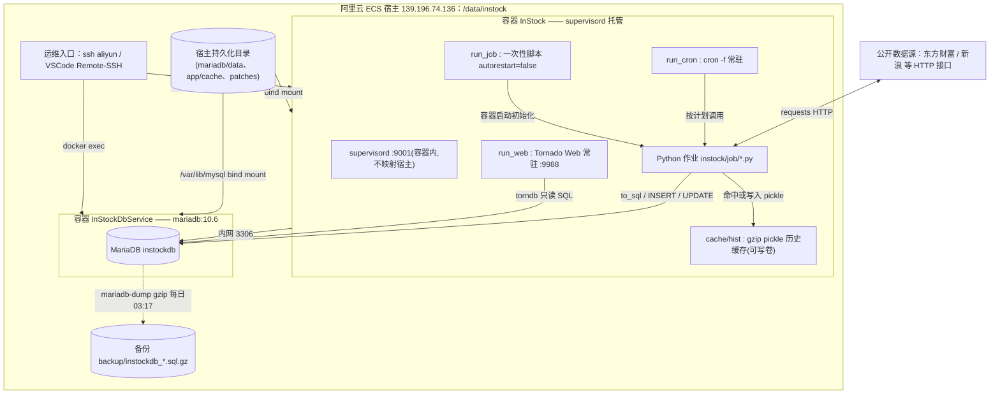
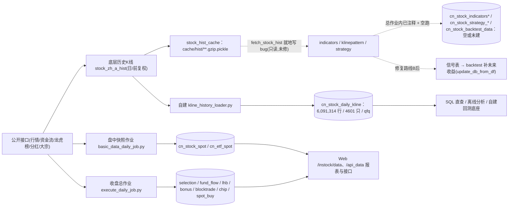

# InStock 数据流说明 + 容器进入指南 + 运维脚本集（实测版）

> 主机：`139.196.74.136`（root）｜编排目录 `/data/instock`
> 容器：`InStock`（应用，镜像 `16f0ce698022`）、`InStockDbService`（MariaDB 10.6）
> 库：`instockdb`；账号 `root/root`；应用 Web `:9988`
> 说明：图为 Mermaid，VSCode 安装 “Markdown Preview Mermaid Support” 或 GitHub/Typora 直接预览；命令均已在服务器实测。

---

## 1. 部署与运行架构图（谁在跑、连到哪、数据落哪）



要点：
- **两个容器在 `instock-net` 内网互通**，应用只通过内网 DNS `InStockDbService:3306` 连库；宿主不暴露 DB 3306 与 supervisor 9001，只把 Web `9988` 映射到宿主。
- **所有持久化数据都在宿主 `/data/instock` 卷里**，容器重建/重启不丢库、不丢缓存、不丢自建入库结果。
- `run_job` 一次性执行初始化类作业且 `autorestart=false`（正常退出不算故障）；`run_web`、`run_cron` 常驻且 `autorestart=true`；三程序由 `supervisord` 拉起。

---

## 2. 数据流总图（采集 → 缓存/计算 → 入库 → 消费；含阻断与自建旁路）



图例：实线＝当前真实跑通的数据通路；虚线＝被阻断/未启用/规划中；绿色旁路＝本期自建、不依赖上游 bug 链。

### 2.1 五层数据流文字说明

| 层 | 组件 | 干什么 | 落地位置 |
|---|---|---|---|
| L0 数据源 | 东财 `push2his/push2`、新浪等 `requests` HTTP | 抓快照、资金流、龙虎榜、分红、历史日K | 内存 DataFrame（不落文件） |
| L1 采集调度 | 容器 `cron` → `run-parts` 脚本 → `job/*.py` → `run_template.run_with_args` → `stockfetch.fetch_*` → `crawling/*` | 按交易日、按时刻拉数；无参=最近交易日 | 调用日志 `stock_execute_job.log` |
| L2 计算/缓存 | `TA-Lib` 指标；`stock_hist_cache` 读写 `cache/hist` gzip pickle；`pandas` | 取历史序列、算指标/形态/信号 | pickle 缓存卷；指标/信号（当前阻断） |
| L3 存储 | `database.py`（SQLAlchemy+PyMySQL、torndb） | `to_sql(append)` 自动建表、补主键；快照先 `DELETE WHERE date=?` 再插；回测 `UPDATE` | MariaDB `instockdb` |
| L4 消费 | Tornado `web_service.py`；自建 SQL；策略/回测（待修复） | 网页报表、JSON API、自选；后续信号与收益 | 浏览器/外部查询 |

### 2.2 写入语义（为什么重跑不会全表重复）

- **快照类表**（`cn_stock_spot`、`cn_stock_fund_flow` 等）：主键 `(date,code)`；作业先 `DELETE FROM t WHERE date='当日'` 再 `INSERT`，即“**当日覆盖、多日累积**”。按日分组即可看到每日一份：
  `SELECT date,COUNT(*) FROM cn_stock_spot GROUP BY date ORDER BY date DESC LIMIT 5;`
- **自建历史表 `cn_stock_daily_kline`**：主键 `(code,date,adjust)` + `INSERT IGNORE`，跨日跨次重跑幂等、只补缺不重复。
- **回测表**：`update_db_from_df` 按条件 `UPDATE` 补未来 N 日收益（依赖先有信号记录）。

---

## 3. 定时调度时间线（容器内 cron，源码实测）

容器 `/var/spool/cron/crontabs/root`：

| 时刻（周一至五 `1-5`） | 触发脚本 | 实际执行 Python | 主要写入表 | 状态 |
|---|---|---|---|---|
| `*/30 9,10,11,13,14,15` | `/etc/cron.hourly/run_hourly` | `basic_data_daily_job.py` | `cn_stock_spot`、`cn_etf_spot` | 启用、正常 |
| `30 17 * * 1-5` | `/etc/cron.workdayly/run_workdayly` | `execute_daily_job.py` | spot/etf、`cn_stock_selection`、`cn_stock_fund_flow(_industry/_concept)`、`cn_stock_bonus`、`cn_stock_lhb`、`cn_stock_chip_race_open`、`cn_stock_limitup_reason`、`cn_stock_spot_buy`、`cn_stock_blocktrade`、`cn_stock_chip_race_end` | 启用；但**指标/形态/策略/回测在 main() 内被注释** |
| `30 10 * * 3,6` | `/etc/cron.monthly/run_monthly` | `rm -rf cache/hist/*` | 清理 pickle 缓存（不删 MySQL 数据） | 启用 |

`execute_daily_job.main()` 实际调用顺序（实测源码）：
`init_job` → `basic_data_daily_job`（spot+etf）→ `selection_data_daily_job`（综合选股）→ 线程池 `basic_data_other_daily_job`（资金流/板块流/分红/龙虎榜/抢筹/涨停原因，内部派生基本面选股 `spot_buy`）→ `basic_data_after_close_daily_job`（大宗交易/尾盘抢筹）。
被注释、不执行：`indicators_data_daily_job`、`klinepattern_data_daily_job`、`strategy_data_daily_job`、`backtest_data_daily_job`（且其中前几个还受 pandas 只读 bug 阻断）。

### 作业命令行契约（argv，来自 `run_template.py`）
- **不带参数（推荐，cron 默认）**：取最近交易日；`save_nph*` 以 `before=False` 真正落表；
- 1 个参数 `YYYY-MM-DD,...`：多日；2 个参数 `起 止`：区间逐日（仅交易日提交）；
- 区间/指定日期模式下 `save_nph*` 默认 `before=True` 直接 `return`，**不会补历史快照**，别用历史日期去重跑实时快照作业。

---

## 4. 关键数据通路详解

### 4.1 盘中实时快照（已跑通）
`cron(每30分钟)` → `basic_data_daily_job.py` → `singleton stock_data` / `stf.fetch_stocks()`（`stock_zh_a_spot_em`）+ `fetch_etfs()`（`fund_etf_spot_em`）→ DataFrame → `DELETE 当日 + insert_db_from_df` → `cn_stock_spot`、`cn_etf_spot`。
- 实测：`cn_stock_spot` 最新 `2026-11-09` 当日 4601 行；`cn_etf_spot` 当日 1641 行。

### 4.2 收盘综合数据（已跑通）
17:30 `execute_daily_job.py` 串联抓取并落库；资金流由 4 个指标名次 `merge` 成宽表；`spot_buy` 是从 spot 按 `PE_TTM 0~20、PB≤10、ROE≥15` 过滤派生。

### 4.3 上游历史日K → pickle → 指标链（当前阻断点）
`stock_hist_data(workers=16)` → `fetch_stock_hist` → `stock_hist_cache(code)`：
- 未命中：调 `stock_zh_a_hist(daily,qfq)`，写 `cache/hist/YYYYMM/<start>/<code>qfq.gzip.pickle`；命中：直接 `read_pickle`；
- 随后 `tl.ROC` 算涨跌幅，并执行 `data['p_change'].values[np.isnan(...)] = 0.0` —— **pandas3 CoW 下该就地写抛 `assignment destination is read-only`**，导致 `fetch_stock_hist` 返回 None，指标/形态/策略空跑。
- 修复（路线B，见第 8 节）：就地写改 `fillna`，先 `stockfetch.py` 两处打通供给，再扩指标/策略。

### 4.4 自建历史日线入库（本期完成、已跑通、独立旁路）
`kline_history_loader.py` → 直接调底层 `stock_zh_a_hist(20210101→今, qfq)` → `INSERT IGNORE` 进 `cn_stock_daily_kline`；不经过 `fetch_stock_hist`，绕开阻断点。
- 实测：6,091,314 行 / 4601 只 / 2021-01-04→2026-11-06；`COUNT(*)=COUNT(DISTINCT code,date,adjust)` 无重复；`missing_codes=0`；OHLC 空值 0；失败清单 0。

### 4.5 Web 消费（已跑通报表；个股指标图受 4.3 影响）
`web_service.py` 路由：

| 路由 | 作用 | 数据来源 |
|---|---|---|
| `/`、`/instock/` | 首页 | 静态模板 |
| `/instock/api_data?name=&date=` | 报表 JSON | torndb 查快照/结果表 |
| `/instock/data?table_name=` | 报表 HTML 页 | 同上 |
| `/instock/data/indicators?code=&date=&name=` | 个股K线指标图 | 内部走历史供给链（当前可能空白，待路线B） |
| `/instock/control/attention?code=&otype=` | 自选增删 | `cn_stock_attention` |

### 4.6 策略与回测（未启用/待修复）
策略作业扫历史序列产出 `cn_stock_strategy_*` 信号；`backtest_data_daily_job` 只扫信号表中未来收益为空的记录、用 `rate.get_rates` 补收益并 `UPDATE` 回写。**当前无信号 → 无回测记录**，不是数据库损坏。

---

## 5. 数据库表清单与实测状态（`instockdb`）

| 表 | 含义 | 来源作业 | 状态（实测） |
|---|---|---|---|
| `cn_stock_spot` | 个股每日快照 | basic_data_daily_job | 多日累积，当日4601 |
| `cn_etf_spot` | ETF 快照 | basic_data_daily_job | 正常 |
| `cn_stock_selection` | 综合选股 | selection_data_daily_job | 正常（最近 11-06） |
| `cn_stock_fund_flow` | 个股资金流 | basic_data_other | 正常（最近 11-06） |
| `cn_stock_fund_flow_industry/_concept` | 行业/概念资金流 | basic_data_other | 正常 |
| `cn_stock_bonus` | 分红配送 | basic_data_other | 正常 |
| `cn_stock_lhb` | 龙虎榜 | basic_data_other | 正常 |
| `cn_stock_blocktrade` | 大宗交易 | after_close | 正常（少量行） |
| `cn_stock_chip_race_open/_end` | 早盘/尾盘抢筹 | other/after_close | 正常（各约100） |
| `cn_stock_limitup_reason` | 涨停原因 | basic_data_other | 正常（少量） |
| `cn_stock_spot_buy` | 基本面选股派生 | 由 spot 过滤 | 正常（少量） |
| `cn_stock_attention` | 我的关注 | Web 操作 | 空表（未自选） |
| **`cn_stock_daily_kline`** | **自建前复权日线** | **kline_history_loader** | **6,091,314 行/4601 只** |
| `cn_stock_indicators(_buy/_sell)` | 指标/买/卖信号 | indicators job | 未建/空（阻断+注释） |
| `cn_stock_pattern_recognitions`、`cn_stock_pattern` | K线形态 | klinepattern job | 未建/空（阻断+注释） |
| `cn_stock_strategy_*`（10类策略） | 策略信号 | strategy job | 未建/空（阻断+注释） |
| `cn_stock_backtest_data` | 回测收益 | backtest job | 未建/空（依赖信号） |

> 精确查看：`bash /data/instock/ops.sh tables`（全表+估算行）、`bash /data/instock/ops.sh counts`（核心表精确行+最新日期）。

---

## 6. 怎么进 Docker / 进数据库（实操步骤）

### 6.1 前置：先 SSH 到主机（已在 `~/.ssh/config` 配 Host `aliyun`）
```bash
ssh aliyun                       # 等价 root@139.196.74.136
cd /data/instock                 # 所有编排与持久化文件在这里
```
Windows PowerShell 下等价：
```powershell
C:\Windows\System32\OpenSSH\ssh.exe aliyun
```

### 6.2 进入应用容器 Shell（交互式）
```bash
docker exec -it InStock sh                 # 容器是 slim 镜像, 用 sh(bash 可能未装)
# 容器内常用位置:
ls /data/InStock                           # 应用根
ls /data/InStock/instock/job               # 作业脚本
ls /data/InStock/instock/web               # Tornado 代码与 templates
ls /data/InStock/instock/cache/hist        # 历史pickle缓存
ls /data/InStock/instock/log              # 作业/Web落盘日志: stock_execute_job.log、stock_web.log
python3 -c "import talib;print(talib.__version__)"   # 验证TA-Lib=0.6.8
exit
```
非交互单条命令（不进交互）：`docker exec InStock python3 /data/InStock/instock/job/basic_data_daily_job.py`

### 6.3 进入数据库（交互式）
```bash
docker exec -it InStockDbService mariadb -uroot -proot instockdb
-- 常用:
SHOW TABLES;
SELECT COUNT(*), MAX(date) FROM cn_stock_spot;
SELECT date,COUNT(*) FROM cn_stock_spot GROUP BY date ORDER BY date DESC LIMIT 5;
SELECT code,name,date,close,volume FROM cn_stock_daily_kline WHERE code='600519' ORDER BY date DESC LIMIT 5;
exit
```
> 容器内客户端命令是 `mariadb`/`mariadb-admin`，不是 `mysql`/`mysqladmin`；SQL 加 `--default-character-set=utf8mb4` 可避免中文显示 `????`。
> 非交互：`docker exec InStockDbService mariadb --default-character-set=utf8mb4 -uroot -proot instockdb -e "SQL"`（也可用 `bash ops.sh sql "SQL"`）。

### 6.4 端口与网络对照

| 项 | 宿主 | 容器内 | 是否暴露公网 |
|---|---|---|---|
| Tornado Web | `127.0.0.1:9988` / `0.0.0.0:9988` | `:9988` | compose 映射了 9988；建议先用 SSH 隧道 |
| MariaDB | 不映射 | `InStockDbService:3306` | 仅容器内网，宿主/外网不可连 |
| supervisord | 不映射 | `:9001` | 不暴露 |

SSH 隧道访问 Web（推荐，免开公网端口）：
```powershell
# 本地另开一个 PowerShell 窗口保持连接
C:\Windows\System32\OpenSSH\ssh.exe -N -L 9988:127.0.0.1:9988 aliyun
# 浏览器打开 http://127.0.0.1:9988/instock/
```

### 6.5 宿主 ↔ 容器路径映射（数据不随容器消失的原因）

| 宿主 `/data/instock/...` | 容器内 | 用途 |
|---|---|---|
| `mariadb/data` | `/var/lib/mysql` | 数据库数据文件 |
| `app/cache` | `/data/InStock/instock/cache` | hist pickle、自建 loader 与断点/日志 |
| `patches/eastmoney_fetcher.py` | `/data/InStock/instock/core/crawling/eastmoney_fetcher.py:ro` | br 编码修复（只读挂载） |
| `docker-compose.yml` | — | 编排定义（网络、卷、restart、healthcheck、环境变量） |
| `backup` | — | gzip 逻辑备份（容器外） |

---

## 7. 运维脚本集 `ops.sh`（宿主 `/data/instock/ops.sh`，已上传自测）

用法：`bash /data/instock/ops.sh <子命令>`；`bash /data/instock/ops.sh help` 查看全量。

### 7.1 只读巡检（日常首选，全部已实测）
| 命令 | 作用 |
|---|---|
| `ops.sh status` | compose 状态、Web 200 探活、supervisor 程序、关键进程、资源、镜像 |
| `ops.sh health` | status + 核心表行数 + 质量核查 + 备份清单（综合体检） |
| `ops.sh tables` | 全部表 + InnoDB 估算行数 |
| `ops.sh counts` | 核心表精确行数与最新交易日 |
| `ops.sh verify` | 历史表主键去重、缺失代码、行数分布、OHLC 空值、蓝筹抽样 |
| `ops.sh kline-status` | 入库进程、done/failed 断点、历史表覆盖、失败清单 |
| `ops.sh kline-log [N]` | 历史入库日志/进度尾部 |
| `ops.sh logs-docker [N]` | 应用容器 stdout 日志 |
| `ops.sh logs-app` | 作业落盘日志 `stock_execute_job.log`、Web 日志尾部 |
| `ops.sh backup-list` | 备份文件列表 |
| `ops.sh cache-list` | hist pickle 缓存占用与文件数 |
| `ops.sh sql "<SQL>"` | 非交互执行任意 SQL（自动 utf8mb4） |

### 7.2 进入类（需在已 SSH 会话中交互执行）
| 命令 | 作用 |
|---|---|
| `ops.sh enter` | 进应用容器 shell |
| `ops.sh db` | 进 MariaDB 交互客户端 |

### 7.3 手动触发作业（写操作，谨慎；无参=最近交易日）
| 命令 | 等价动作 |
|---|---|
| `ops.sh job-basic` | 跑 `basic_data_daily_job.py`（个股+ETF 快照） |
| `ops.sh job-close` | 跑 `execute_daily_job.py`（收盘总作业） |
| `ops.sh job-afterclose` | 跑 `basic_data_after_close_daily_job.py` |
| `ops.sh job-run <py> [args...]` | 任意作业并透传参数（注意第 3 节 argv 契约） |

### 7.4 自建历史日线入库
| 命令 | 作用 |
|---|---|
| `ops.sh kline-run [起YYYYMMDD] [并发]` | 后台断点续跑；默认 `20210101` / `10`；`INSERT IGNORE` 幂等 |
| `ops.sh kline-stop` | 停止入库进程（已提交行保留，可再 `kline-run` 续跑） |
| `ops.sh kline-status` | 查看进度与覆盖 |

### 7.5 备份与恢复
| 命令 | 作用 |
|---|---|
| `ops.sh backup-now` | 立即 `mariadb-dump --single-transaction | gzip` 备份 |
| `ops.sh backup-list` | 查看备份 |
| `ops.sh backup-restore <文件.gz>` | **只打印**恢复命令，不执行（防误操作） |
| `ops.sh backup-restore --confirm <文件.gz>` | 真正覆盖 `instockdb`（危险，执行前先确认文件） |

每日 03:17 由宿主 crontab 自动执行 `backup_db.sh`，保留 14 天。

### 7.6 重启与缓存
| 命令 | 作用 |
|---|---|
| `ops.sh restart-app` | 重启应用容器（数据在卷，不丢） |
| `ops.sh restart-db` | 重启 DB 容器 |
| `ops.sh restart-all` | compose 重启两服务 |
| `ops.sh cache-clear` | 清空 `cache/hist` pickle（等价月度任务；不影响 MySQL） |

---

## 8. 已知问题、修复路线与排错速查

### 8.1 待修复：pandas 只读就地写（路线B，功能缺口，不影响本期历史表）
- 现象：`assignment destination is read-only`，共 102 处/8 文件；直接影响 `fetch_stock_hist` → 指标/形态/策略。
- 处置顺序（入库已完成、可择机做，重建 app 前先确认无 `docker exec` 批处理在跑）：
  1. `stockfetch.py` 两处 `data['p_change'].values[np.isnan(...)]=0.0` 改为 `data.loc[:,'p_change']=data['p_change'].fillna(0.0)`，先打通 `fetch_stock_hist`；
  2. 单票验证非 None → 单票指标出值 → 小批量 → 全市场；
  3. 再改 `calculate_indicator.py`(93) 与策略 6 文件(9)；盘后按 指标→形态→策略→回测 顺序跑链；作业并发 `workers` 由 40 降到 8–16。
- 本脚本集的 `job-close` 会执行上游总作业，但其指标/策略段当前本就被注释，属预期，不是脚本问题。

### 8.2 排错速查（静默失败先看“日志 + 表行数”，不要只看进程退出码）
| 现象 | 排查命令/思路 |
|---|---|
| 作业跑完某表为空 | `ops.sh logs-app`；确认是否非交易日/接口限流/except 吞错；`ops.sh counts` 看最新日期 |
| 中文显示 `????` | 客户端加 `--default-character-set=utf8mb4`（库内不乱码） |
| 容器内 `ps: not found` | 用宿主 `docker top InStock`（容器精简无 ps/pgrep） |
| `mysqladmin not found` | 用 `mariadb-admin ping` / `mariadb` |
| 长字段 `r.json()` 报错 | 已由只读挂载补丁把请求头降级为 `gzip, deflate`；勿重建覆盖 `patches` 卷 |
| Web 9988 打不开 | `ops.sh status`；先确认容器 Up、Web=200；公网访问需安全组+反代，当前建议 SSH 隧道 |
| 历史表想补某日之后增量 | `ops.sh kline-run 20261101 10`（区间起点），幂等追加 |
| 磁盘增长 | `docker system df`；`ops.sh cache-list`；确认稳定后再评估 `notalib-bak` 镜像清理 |

### 8.3 安全与边界
- Web 无认证、`debug=True`、`xsrf_cookies=False`、`cookie_secret` 硬编码：仅适合本机/隧道内网使用；对公网暴露前需反向代理加认证/HTTPS，并在控制台配安全组白名单。
- 无实盘下单能力（easytrader 绑定 Windows GUI）；本系统是数据采集 + 选股/回测计算。
- 数据源为公开爬虫型接口，受限流/改版影响；个人研究使用，商用需另行核上游授权。
- `cn_stock_daily_kline` 固化为 qfq 前复权，历史价会随新除权除息调整；若需不可变序列，可用 `KLINE_ADJUST=hfq`/空 另跑口径（表已留 `adjust` 列区分）。

---

## 9. 一分钟上手（典型顺序）

```bash
ssh aliyun
bash /data/instock/ops.sh health          # 1. 体检
bash /data/instock/ops.sh counts          # 2. 看表数据是否最新
bash /data/instock/ops.sh kline-status    # 3. 看自建历史日线
bash /data/instock/ops.sh sql "SELECT date,COUNT(*) FROM cn_stock_spot GROUP BY date ORDER BY date DESC LIMIT 5;"
bash /data/instock/ops.sh db               # 4. 交互查库(可选)
# 需要时: job-close 收盘作业 / kline-run 历史入库 / backup-now 备份
```
